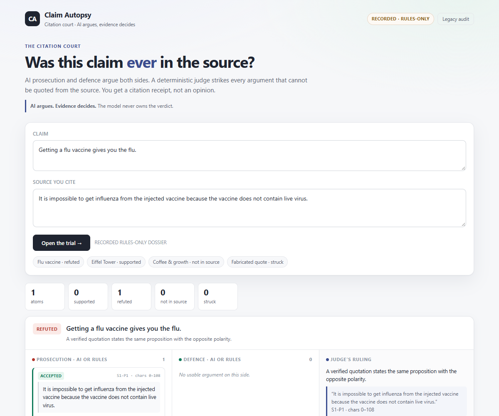

# Claim Autopsy

**AI argues. Evidence decides.**

Claim Autopsy is a citation court. You paste a claim and the source you think supports it. An AI prosecutor and an AI defence each propose arguments with exact quotations. A deterministic judge then checks every quotation character by character, along with relation, subject, population, object, endpoint, quantity, strength and polarity. Any argument that cannot be quoted from the source is struck on the spot. The verdict belongs to the judge, never to the model.

The product answers one narrow question: **does this source actually state this claim?** It is not an open-web fact checker and it does not decide whether a claim is true in the world. It decides whether the supplied text supports it, refutes it, or never says it.



## What a user gets

- **A per-atom finding, never silence.** Every independently checkable atom receives `supported`, `refuted`, or `not_in_source`. If the source does not state it, the nearest sentence and its coverage are shown so the user can see why.
- **A three-column trial.** Prosecution, defence, and the judge's ruling. Accepted arguments carry the exact quotation, evidence id and character offsets. Every argument is marked `AI` or `RULE`, so the reader can see which side the model actually produced. Struck arguments stay visible with a reason code.
- **A citation receipt.** The dossier has a content-addressed `run_id`, the source hash, the model name, and the full argument ledger. The same input produces the same judge output. You can copy the JSON or download a Markdown receipt from the result.
- **Built for a real passage.** Paste the source, or load a `.txt`/`.md` file (or drop one on the box). The character count is shown before the run, and a source over the 20,000-character limit is rejected with a plain explanation instead of a silent truncation.
- **A working fallback.** If no model is available, the court still runs as a rules-only docket. The page says so; it never pretends a model ran.
- **Multi-source triage.** One claim against up to 8 candidate sources. Rules triage every source first; AI is spent only on sources the rules cannot settle. Duplicate sources collapse by SHA-256, and a `supported` + `refuted` split is reported as a cross-source conflict without picking a winner.
- **An auditable semantic bridge.** When the source uses a synonym (aspirin / acetylsalicylic acid), the model may propose anchor pairs. The judge rewrites the claim with those pairs and reruns every structural check. Anchors cannot touch negation, relation verbs or numbers; ungrounded anchors are struck.

Who it is for: students and researchers checking a citation before submitting, editors checking an AI-assisted draft, and anyone who has been handed a confident sentence with a vague source.

## Quick start

**Zero-install review (no clone, no model, no key):** open the public Pages page and paste any claim and source:

`https://guyuezheng33-ai.github.io/claim-autopsy/web/index.html`

**Local run (optional):** the runtime is Python standard library only. The 2.0 GB local model is **optional** — without it the court still runs as a rules-only docket and says so on the page; you do not need to download anything to review the kernel, fixtures or UI.

```bash
# optional: download the local model once (2.0 GB, Q4_K_M; 1.5B and 7B profiles also exist)
python tools/get_model.py --size 3b

# start the page; works rules-only if no model is present
python serve.py
# http://127.0.0.1:8765
```

`serve.py` finds the model in `%LOCALAPPDATA%\claim-autopsy\models` or `models/`, starts `llama-server` on loopback, and waits for it. The model runs on CPU with `-ngl 0`; no API key and no outbound request are required. The measured 3B default takes about 20–35 seconds per docket on this CPU; the 1.5B fast profile takes about 8–12 seconds. The live page streams real stage updates (`/api/trial_stream`) so the wait shows rules triage, evidence packaging, AI advocacy and judge verification instead of a blank spinner.

You can also open `web/index.html` directly. It works without a server and without a model, but it is a **recording**: the default docket is a real local Qwen run recorded into `data/court_replay.json`, labelled `RECORDED LIVE AI RUN`. The public GitHub Pages page is different: it calls a hosted Qwen2.5-3B endpoint, so any pasted claim/source can be tested live. Only `/api/status` + a real trial receipt can produce `HOSTED LIVE · 3B` and `LIVE AI · JUDGE VERIFIED`.

For the fastest zero-install review, open `https://guyuezheng33-ai.github.io/claim-autopsy/web/index.html`, paste a claim and source, and click **Open the trial**. For a stable five-step read, use `web/index.html?judge=1`: judge mode hides the free-form form, starts on step 1, and gives a five-step rail. Step 1 is an adversarial fabricated quotation struck as `quote_not_found`; step 2 is a real recorded 1.5B mistake (`side_mismatch`); the last step pulses the receipt actions. The shorter `web/index.html?demo=struck` link preloads only the proof.

If you have a cloud key, the same code path uses it:

```bash
LLM_API_KEY=... python serve.py
```

`/api/status` reports the actual mode. `/api/health` lists the nine endpoints.

## Three-minute judge path

Open the public hosted page to test a claim live:

`https://guyuezheng33-ai.github.io/claim-autopsy/web/index.html`

`?judge=1` is the stable five-step rail:

`https://guyuezheng33-ai.github.io/claim-autopsy/web/index.html?judge=1`

Public 57.4-second visual walkthrough (embeds the captioned MP4): `https://guyuezheng33-ai.github.io/claim-autopsy/web/demo.html`

The hosted trial calls Qwen2.5-3B on CPU. A cold model can take up to a minute; the page shows
`HOSTED · WAKING 3B` and retries, then `HOSTED API OFFLINE` rather than falling back silently.
The black-box receipt is `evidence/hosted_live.json`; re-run it with
`python tools/check_hosted_live.py`.

On the `?judge=1` link, the page starts on step 1 and hides the free-form form. Use the rail, or **Next →**:

1. **1 · Trap** — the adversarial quotation is struck as `quote_not_found`; the verdict stays `refuted`.
2. **2 · Real mistake** — a recorded 1.5B run is struck as `side_mismatch`.
3. **3 · Accepted quote** — the flu case shows the accepted quotation, offsets `0-108`, and the source highlight.
4. **4 · Conflict** — one claim against four sources shows `cross-source conflict` without picking a winner.
5. **5 · Receipt** — returns to the struck trap case, then scrolls to and pulses the JSON/Markdown receipt actions, closing the loop with `quote_not_found`.

The full click-by-click script is in [`JUDGE_PATH.md`](JUDGE_PATH.md). The first case is an
adversarial fixture; the second is a real recorded model run. The page labels both.

## How the AI is used

| Role | Who | Allowed | Not allowed |
|---|---|---|---|
| Prosecution | Qwen2.5-3B-Instruct (local GGUF) | Propose arguments that the source contradicts the claim; each must carry `atom_id`, `evidence_id`, verbatim `quote`, relation, rationale and optional semantic `anchors` | Output a verdict, invent evidence ids, paraphrase the quote, use outside facts |
| Defence | Same model, separate call, run in parallel | Propose arguments that the source supports the claim | Same limits |
| Judge | `core/court.py`, deterministic Python | Check exact quotation, relation, subject, population, object, endpoint, quantity, strength, polarity; accept or strike; issue the verdict | Delegate the verdict to the model |
| Clerk | Not implemented | — | — |

The AI is not decoration. Without it the dossier has zero proposed arguments: the rules-only docket can still reach a verdict, but it cannot show two adversarial cases, cannot surface a plausible but fabricated quotation for the judge to strike, and cannot show the user what a model would have claimed. With it, the product's central experience exists: **the model argues, the evidence rejects**.

Strict protocol: one call per side, JSON only, at most 3 arguments per atom per side, at most 8 atoms. Unknown evidence ids, unknown atoms, malformed JSON, invented quotations and model errors are dropped before the judge sees them. The model never writes `verdict`.

## Representative input and output

Input:

```text
Claim:  Getting a flu vaccine gives you the flu.
Source: It is impossible to get influenza from the injected vaccine because the vaccine does not contain live virus.
```

Live local run (recorded in `evidence/court_live.json`):

```json
{
  "verdict": "refuted",
  "ai_mode": "ai",
  "model": "qwen2.5-1.5b-instruct-q4_k_m.gguf",
  "arguments": [
    {"side": "prosecution", "relation": "contradicts", "status": "accepted",
     "quote": "It is impossible to get influenza from the injected vaccine because the vaccine does not contain live virus.",
     "char_start": 0, "char_end": 108},
    {"side": "defense", "relation": "contradicts", "status": "struck",
     "strike_codes": ["side_mismatch"],
     "strike_reason": "quotation points the other way"}
  ],
  "summary": {"refuted": 1, "accepted_arguments": 1, "struck_arguments": 1}
}
```

The defence tried to use the same sentence on the wrong side. The judge struck it. The verdict remained the judge's. `court_live.json` now keeps both local models under `runs` (1.5B and 3B); this sample is the 1.5B recording the static page replays, not a claim that the two models behave identically.

## Architecture

```text
L0  Input             claim + source (bounded, empty rejected)
L1  Triage            rule-based atom split; language/length/empty checks
L2  Evidence packet   sentence split, char offsets, quote hashes, source hash
L3  Advocates         AI prosecution + AI defence, one call each, parallel
L4  Judge             deterministic quote/relation/subject/population/object/
                      endpoint/quantity/strength/polarity checks
L5  Dossier           per-atom verdict, accepted/struck ledger, nearest sentence,
                      what-would-change-it, receipt
L6  Audit             fixtures, live evidence, 48 gates, SHA-256 run receipt
```

Key files:

| File | Responsibility |
|---|---|
| `core/court.py` | evidence packet, judge, rule arguments, dossier, 33 fixtures |
| `data/court_cases.json` | 12 verdict fixtures + 13 argument fixtures + 5 anchor fixtures + 3 input fixtures |
| `core/court_batch.py` | one claim × up to 8 sources; SHA-256 dedup, rules triage, capped AI, cross-source conflict |
| `data/court_batch_cases.json` | 6 batch fixtures: duplicate, conflict, all-not-in-source, eight sources, ninth refused, empty |
| `core/llm.py` | cloud/local provider, 3B/1.5B/7B profiles, llama-server lifecycle, strict advocate JSON, forced anchor completion and orientation repair |
| `core/court_live.py` | records real model runs to `evidence/court_live.json`; keeps each local model under `runs`; refuses to write without a model |
| `serve.py` | HTTP page, `/api/trial`, `/api/trial_stream` (ordered NDJSON progress), `/api/trial_multi`, `/api/status`, `/api/health`, static JS; public-hosted limits and CORS preflight |
| `web/court.js` | renders the dossier; single and batch modes; hosted endpoint or local same-origin; recorded AI is labelled as recorded |
| `web/court_replay.js` | recorded dossiers, including real local-AI runs and one labelled adversarial fixture |
| `web/court_batch_replay.js` | one real recorded four-source batch for the static page |
| `tools/build_court_replay.py` | merges recorded AI runs into the static replay without relabelling them live |
| `tools/build_court_batch_replay.py` | freezes a real batch run into the static replay |
| `tools/run_ai_uplift.py` | the rules-lose / anchored-AI-wins baseline, honest live results to `evidence/ai_uplift.json` |
| `core/audit.py` | 48 gates, including A45 court floor, A46 firewall, A47 batch, A48 baseline |
| `tools/make_receipt.py` | binds the green run to its artefact hashes |

## Reproduce on a clean machine

- **Requirements:** Python 3.11 or newer. The application runtime is the Python standard library only; there is no web framework, database or vector store. `pytest` in `requirements.txt` is a development-only convenience and is not needed to run the tests below.
- **One command, invariant tests:**

```bash
python -m unittest discover -s tests -t .
```

- **Court fixtures (33 cases, headless):**

```bash
python -m core.court --fixtures
```

- **Local UI (optional model):** `python serve.py`; without a downloaded model it serves the rules-only docket.
- **CI:** `.github/workflows/tests.yml` runs the invariant tests and the court fixtures on every push and pull request against Python 3.11 and 3.13; a red run blocks merge the same way a local failure does.

## What is tested

```bash
python -m core.court --fixtures      # 33/33 court fixtures
python -m core.court --live          # real local model, writes evidence/court_live.json
python tools/browser_check.py        # Edge: court, 10 legacy demos, 3 citation demos
python tools/browser_check_live.py   # Edge: live /api/trial_stream progress panel
python tools/check_hosted_live.py    # black-box public endpoint: status, CORS, real 3B trial
python -m core.audit final           # 48 gates
python tools/make_receipt.py final --bootstrap
python tools/make_receipt.py final
python tools/check_manifest.py --write
```

The court floor test covers: refutation, verbatim support, not-in-source, quantity mismatch, population mismatch, relation mismatch, antibiotic synonymy, double negation, two atoms, conflict, prompt injection, fabricated quotation, unknown evidence id, side mismatch, too-short quote, empty quote, empty source, CJK input and an over-length claim. Every atom must have a finding; every accepted argument must carry a quote hash and offsets; two runs of the same input must produce the same judge output.

The AI firewall test (A46) proves six separate things: a valid quotation is accepted; a forged quotation is struck as `quote_not_found`; an unknown evidence id is struck as `unknown_evidence`; a model that says something else still cannot change the judge's verdict; a grounded anchor bridge wins a case the rules lose; and an ungrounded anchor is struck. A47 proves the multi-source batch boundaries and cross-source conflict; A48 proves the rules-lose / anchored-AI-wins baseline on 8 fixed cases.

## Failure cases and limits

These are real, not decorative.

1. **The model fabricated a quotation.** In the adversarial fixture, the prosecution invented “The flu vaccine contains live virus and causes influenza.” The judge struck it with `quote_not_found`; it never entered the verdict. The same path is enforced in A46.
2. **The local model produced garbage on the Vulkan backend.** With default GPU offload, Qwen emitted repeated garbled tokens (`GGGG…` / `UmbGGGG…`) instead of JSON. The fix is `-ngl 0` (pure CPU). `serve.py` sets it; a future build that removes it would break the demo.
3. **A 3B model is not a reliable legal opponent.** It sometimes labels its own relation incorrectly, returns `[]` on a genuinely unrelated source, or proposes only one anchor in the full court schema. The judge catches these, which is the product working; it also means the AI side is not a guarantee of eloquence or recall. Forced anchor completion plus one focused question per missing phrase reaches 8/8 on the fixed rule-loss set (recorded in `evidence/ai_uplift.json` with `model_live=true`, `model_uplift=8`, `anchor_causal=8`), not on arbitrary claims.
4. **No key and no model means a rules-only docket.** The page says `RULES-ONLY DOCKET`; it does not fake AI. Static `file://` always says `RECORDED LIVE AI RUN`, never `LIVE`.
5. **One claim at a time; batch is one claim × up to 8 sources; English-first.** Heavy paraphrase or a source in another language can return `not_in_source`. This is a finding about the supplied source, not a claim that the statement is false.
6. **Not an authoritative fact-check.** The judge checks whether the source states the claim, not whether the source itself is correct.

## Stack, data and provenance

- **Runtime:** Python 3.13 standard library; `llama.cpp` `llama-server`; HTML/CSS/vanilla JS. No web framework, no database, no vector store, no build step for the page.
- **Model:** `Qwen/Qwen2.5-3B-Instruct-GGUF`, `qwen2.5-3b-instruct-q4_k_m.gguf` (2.0 GB), served locally on `127.0.0.1:8099`. Optional 1.5B fast profile and 7B profile; optional cloud OpenAI-compatible endpoint via `LLM_API_KEY`.
- **Data:** 112 evidence cards from 41 authoritative sources (legacy corpus audit), 33 court fixtures, 6 batch fixtures, 8 rule-loss/AI-win baseline cases, 6 recorded live cases, 12 citation fixtures. No private user data, no API keys in the repository.
- **Open source:** `llama.cpp` (MIT), Qwen2.5 model (Apache-2.0). The application code is original to this submission.
- **AI assistance:** LLM coding assistance was used during refactoring. All claims about behaviour are backed by local commands and receipts; no evidence or benchmark number was generated by a model.
- **Pre-existing vs event work:** the corpus/citation audit was written earlier in this same build; the court kernel, local model integration, AI firewall, court UI and recorded dossiers were added in the refactor. No other team's project was copied.
- **Team:** one person. Product/architecture, backend and judge, frontend, evaluation. External reviewer sessions and the video are submission materials, not product claims.

## Honest limitations of the demo

The strongest demo is the public hosted page: no install, paste any claim/source, and the hosted
3B runs the trial. The local path (`python serve.py`) is the reproducible fallback. The five-step
rail is a labelled recording, not a live model call. The gap between the hosted live form and the
recorded rail is stated on the page, not hidden.

## License

Application code: MIT. Model and `llama.cpp` remain under their own licenses.

